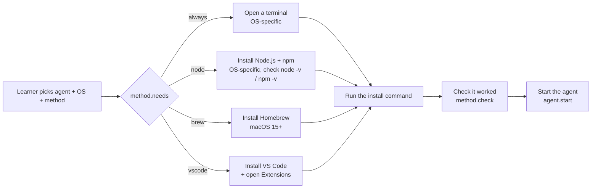

# Agent Lab: Step-by-Step Setup Guide — Specification

| | |
|---|---|
| Version | 1.0, 2026-11-07 |
| Trigger | Learner review of `Agent Lab · AI Accelerator Hub.pdf`. The Install step showed `npm install -g @kilocode/cli` with no instructions on how to open a terminal, or that Node.js and npm must be installed first |
| Parent spec | `docs/PERSONALISED_JOURNEY_BUSINESS_SPEC.md` §7 (Agent Lab) |
| Code | `apps/web/lib/domain/setupGuide.ts` (pure guide builder and facts), `lib/domain/agentLab.ts` (install methods and server checks), `components/learn/SetupGuide.tsx` (visual building blocks) |
| Tests | `apps/web/test/setup-guide.test.ts` |
| Facts verified | 2026-11-07 against the sources in §6. Nothing in the guide comes from memory |

---

## 1. Problem
The learner sees one command and is expected to know four hidden things:
1. what a terminal is and how to open one on their computer
2. that `npm` comes with Node.js, which must be installed first
3. that some commands need Homebrew (macOS) or VS Code first
4. how to tell whether each step worked, and what to do if it didn't

Beginners (Young Coders, Business Owners, AI Builders) get stuck before the lab even starts. Reviewers then get screenshots of error messages instead of a working agent.

## 2. Goal and non-goals
**Goal.** For the agent, computer and install method the learner chooses, show **every step in order, including the prerequisites**, as small visual cards that a first-time terminal user can follow alone. The server checks each piece of proof the learner pastes.

**Non-goals.**
- The platform never runs commands on the learner's computer and never installs anything.
- No screenshots of vendor software are bundled. They go out of date, and we can't verify them. The visuals are *diagrams of the terminal*, built from the commands and example outputs that the vendor docs publish.

## 3. The building blocks
Every guide is a sequence of **Guide Steps**. Each step uses the same four-part card, which follows a reason → act → observe → recover loop (the "ReAct" pattern):

```
┌──────────────────────────────────────────────────────────────┐
│ ③  Install Node.js and npm                       [ ] Done    │
├──────────────────────────────────────────────────────────────┤
│ 🎯 WHY      npm installs Kilo Code. npm comes with Node.js.  │
│ ▶  DO       1. Copy this line, paste it, press Enter         │
│             ┌─ Terminal ────────────────────────────── ⧉ ┐  │
│             │ $ nvm install --lts                          │  │
│             └──────────────────────────────────────────────┘  │
│ 👀 SEE      $ node -v   →  a version such as v24.22.2        │
│ 🛠 IF NOT   "nvm: command not found" → close the terminal,   │
│             open a new one, try again                        │
│                                                  Source ↗    │
└──────────────────────────────────────────────────────────────┘
```

| Block | Purpose | UI component |
|---|---|---|
| **Path rail** | The whole journey at a glance; ticks fill in as steps are done | `PathRail` |
| **Step card** | One action, in the four-part loop | `GuideCard` |
| **Key cap** | Keyboard shortcuts drawn as keys (`⌘` `Space`) | `<kbd>` |
| **Terminal block** | The command, with a prompt glyph (`$` or `PS>`) and a copy button | `TermBlock` |
| **Output block** | What a working result looks like. Only sample outputs printed in the vendor docs, or confirmed version formats, are used | `TermBlock variant="output"` |
| **Fix row** | The most common documented error and its documented fix | `GuideCard.fix` |
| **Source link** | Every card links to the page it came from | `GuideCard.source` |

The rail for Kilo Code CLI on macOS:

```
 [Open terminal] ──▶ [Node.js + npm] ──▶ [Install Kilo CLI] ──▶ [Check it] ──▶ [Start & pick a free model]
       ✓                   ✓                    ●                    ○                    ○
```

## 4. How the guide is assembled (`buildGuide(agent, os, methodId)`)
The guide is deterministic: the same inputs always give the same guide, and no AI is involved.



Prerequisite order: **VS Code → terminal → Homebrew → Node.js**, then install, check and start. A VS Code extension method skips the terminal step.

### 4.1 Install methods (each method declares what it needs and how it's checked)
| Agent | OS | Method | Needs | Check command | What the server accepts |
|---|---|---|---|---|---|
| Claude Code | macOS, Linux | Native installer | — | `claude --version` | `x.y.z (Claude Code)` |
| Claude Code | macOS | Homebrew | brew | `claude --version` | same |
| Claude Code | Windows | PowerShell installer · WinGet | — | `claude --version` | same |
| Codex CLI | macOS, Linux | Installer script | — | start `codex` (the banner shows the version) | `codex … vX.Y.Z` |
| Codex CLI | macOS | Homebrew | brew | same | same |
| Codex CLI | all | npm | **node ≥ 16** (npm `engines`) | same | same, plus `node -v` ≥ 16 |
| Codex CLI | Windows | PowerShell installer | — | same | same |
| OpenCode | macOS, Linux | Install script | — | `ls ~/.opencode/bin` | output contains `opencode` |
| OpenCode | macOS, Linux | Homebrew (`anomalyco/tap/opencode-v2`) | brew | `brew list --versions opencode-v2` | `opencode-v2 x.y.z` |
| OpenCode | macOS, Linux | npm (`@opencode/cli`) | node | `npm ls -g @opencode/cli` | `@opencode/cli@x.y.z`, plus `node -v` |
| OpenCode | Windows | Desktop download | — | the file name you downloaded | `opencode-desktop-win-x64.exe` or `opencode-desktop-win-arm64.exe` |
| Kilo Code | all | VS Code extension (pre-release) | vscode | Extensions view → version | `x.y.z` |
| Kilo Code | all | CLI (`@kilocode/cli`) | node | `kilo --version` | `x.y.z`, plus `node -v` |

**Changed from v1 because the vendor docs changed:**
- OpenCode's docs now publish **v2**: npm `@opencode/cli` (was `opencode-ai`), tap `anomalyco/tap/opencode-v2`, script `https://opencode.ai/v2/install`.
- OpenCode now says "Windows package managers are not supported". Scoop and Chocolatey were **removed**, and Windows learners use the desktop download.
- The start-up instructions `/init` and `AGENTS.md` are no longer in the docs, so the guide now refers only to `/connect`.

### 4.2 Prerequisite cards
| Card | macOS | Windows | Linux | Source |
|---|---|---|---|---|
| **Open a terminal** | `⌘ Space`, type `Terminal`, `Enter` | `Win X` → **Windows PowerShell** (or **Terminal**); the prompt shows `PS C:\Users\…>` | `Ctrl Alt T`, or search "Terminal" | Claude Code terminal guide |
| **Node.js + npm** | **Recommended:** nvm → `curl -o- https://raw.githubusercontent.com/nvm-sh/nvm/v0.41.0/install.sh \| bash`, open a new terminal, `nvm install --lts`. **Or** the LTS **.pkg** installer from nodejs.org | The LTS **Windows Installer (.msi)** from nodejs.org. Keep the defaults, then open a **new** PowerShell window | nvm, as on macOS | npm docs (recommend a version manager), nvm README, Node.js release index |
| Check | `node -v` → `v24.22.2` (format `vMAJOR.MINOR.PATCH`); `npm -v` → `11.19.1` | same | same | Node.js release index (npm ships with every Node.js release) |
| Common fix | Don't use `sudo npm install -g`. Use nvm to avoid permission (EACCES) errors | If PowerShell says *running scripts is disabled*, run `Set-ExecutionPolicy -ExecutionPolicy RemoteSigned -Scope CurrentUser` (Microsoft docs) | — | npm docs; Claude Code docs; Microsoft Learn |
| **Homebrew** | `/bin/bash -c "$(curl -fsSL https://raw.githubusercontent.com/Homebrew/install/HEAD/install.sh)"` (macOS 15 Sequoia or newer) | n/a | n/a | brew.sh |
| **VS Code** | Download from code.visualstudio.com; open the `.dmg` and drag it to Applications | Download the **User Setup** installer | code.visualstudio.com | VS Code docs |
| Open Extensions | `⇧⌘X` | `Ctrl Shift X` | `Ctrl Shift X` | Kilo Code install docs |
| Integrated terminal (alternative) | **View → Terminal**, `⌃` `` ` `` | **View → Terminal**, `Ctrl` `` ` `` | same as Windows | VS Code docs |

**Version numbers aren't hard-coded in instructions.** The guide says "the LTS version" and shows the newest LTS from the Node.js release index only as an *example*. The nvm tag (`v0.41.0`) is pinned, because the nvm README pins it. Staff update it at the cohort re-check (§7).

## 5. Server rules (the install step)
1. `method` must be the **id** of a method that exists for the run's agent **and OS**. Otherwise 400 *Choose one of the install methods shown.*
2. If the method needs Node, `nodeVersion` is **required** and must match `v?MAJOR.MINOR.PATCH`. If the method declares `minNode`, the major version must be ≥ `minNode`. Otherwise 400 with the reason, e.g. *Codex CLI via npm needs Node.js 16 or newer; you have v14.21.3.*
3. `versionOutput` must match **that method's** check pattern, not one pattern per agent.
4. The secret scan runs on every pasted field.
5. Stored as `steps.install.data = { method, nodeVersion? }`. Version output stays in `AgentLabRun.versionOutput`.
6. The reviewer queue shows the method label and Node version alongside the version output.

## 6. Sources (checked 2026-11-07)
- Claude Code: code.claude.com/docs/en/setup and code.claude.com/docs/en/terminal-guide
- Codex: github.com/openai/codex (README); npm registry `@openai/codex` → `engines.node >=16`
- OpenCode: opencode.ai/docs and github.com/anomalyco/opencode (README); npm registry `@opencode/cli` (MIT)
- Kilo Code: kilo.ai/docs/getting-started/installing and kilo.ai/docs/cli (`npm install -g @kilocode/cli`, `kilo`, `kilo --version`); npm registry `@kilocode/cli` (MIT, no engines declared)
- Node.js: nodejs.org/dist/index.json (LTS v26.13.0 and v24.22.2, each bundling npm 11.x, with `.pkg` and `.msi` files); docs.npmjs.com "Downloading and installing Node.js and npm" (recommends nvm; `node -v`, `npm -v`)
- nvm: github.com/nvm-sh/nvm (latest release v0.41.0; `nvm install --lts`; Windows only through WSL; nvm-windows is a separate project)
- Homebrew: brew.sh (install command; macOS Sequoia 15+)
- VS Code: code.visualstudio.com/docs/setup/setup-overview and /docs/terminal/getting-started
- PowerShell: learn.microsoft.com about_Execution_Policies (`Set-ExecutionPolicy -ExecutionPolicy RemoteSigned -Scope CurrentUser`)

## 7. Operations
- **Re-check each cohort.** Staff re-open every source in §6, update `VERIFIED_ON` in `agentLab.ts`, and record changes in this section's change log.
- **Not verified, so not shown:**
  - an OpenCode `--version` command
  - a Codex `--version` command (the banner is used instead)
  - the Kilo VS Code extension ID
  - a minimum Node version for Kilo CLI and OpenCode (they don't declare one)
  - Windows-on-ARM Node installers

### Change log
| Date | Change |
|---|---|
| 2026-11-07 | v1.0. Prerequisite cards; per-method checks; Node version check; OpenCode moved to v2 (npm `@opencode/cli`, tap `opencode-v2`, Windows desktop download; Scoop, Chocolatey and `/init` removed) |

## 8. Acceptance criteria → tests (`test/setup-guide.test.ts`)
| # | Criterion |
|---|---|
| G1 | Every guide starts with how to open a terminal on the learner's OS, except VS Code extension methods, which start with installing VS Code |
| G2 | A method that uses npm always has a Node.js + npm card **before** the install card, with `node -v` and `npm -v` checks |
| G3 | Homebrew methods have a Homebrew card; the native installer has neither a Node nor a Homebrew card |
| G4 | Windows Node cards use the `.msi` and the PowerShell execution-policy fix; macOS and Linux cards use nvm |
| G5 | Every card has why, do, see and a source URL; every command is a string a learner can copy |
| G6 | OpenCode on Windows offers no npm, Scoop or Chocolatey method |
| G7 | Server: an unknown method → 400; an npm method without a Node version → 400; Codex npm with Node 14 → 400; with Node 22 → OK |
| G8 | Server: the version output must match the chosen method's own check pattern |
