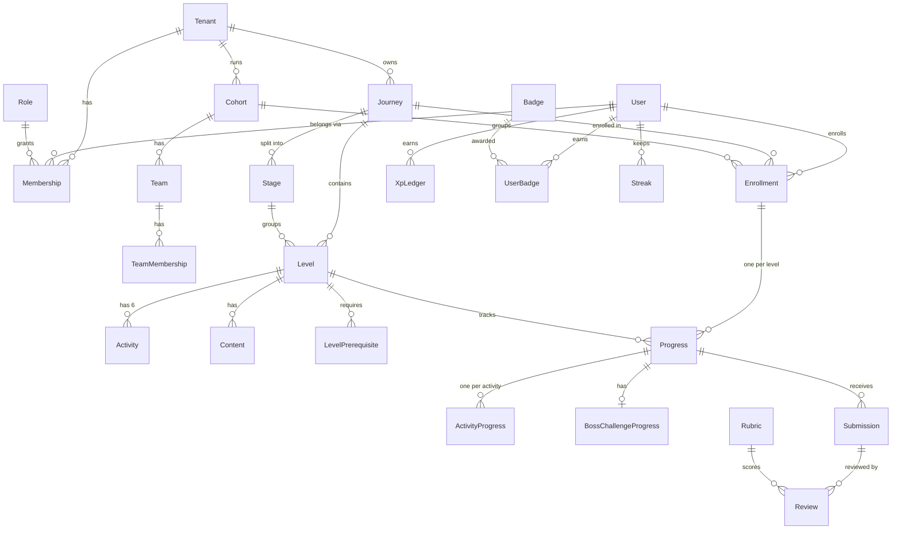

# Data model

The source of truth is `packages/db/prisma/schema.prisma`. This page explains it. If the two disagree, the schema wins; update this page.

| | |
|---|---|
| Database | PostgreSQL 16 (Neon in production, via Vercel) |
| ORM | Prisma 5 |
| Migrations | `packages/db/prisma/migrations` (`0001_init`, `0002_user_area`) |
| Tables | 70 models, table names in `snake_case` via `@@map` |
| IDs | `cuid()` strings |
| Last reviewed | 2026-11-19 |

## Conventions

- **Tenant scoping.** Almost every business row carries `tenantId`. A tenant is one institution (school, company, cohort host). Service code in `apps/web/lib/domain/*` filters by `ctx.tenantId` on every query. Postgres row-level security is written (`packages/db/pg/rls.sql`) but **not applied yet**, so isolation currently depends on application code.
- **Enums are strings.** Status and kind fields are plain `String` columns. The allowed values are in the trailing comment on each field in the schema (for example `state // locked | available | in_progress …`). Validation happens in the domain layer, not the database.
- **JSON is stored as text.** Fields such as `settings`, `config`, `payload`, `metadata` and `rubricScores` are `String` columns holding JSON. Parse with `JSON.parse` and validate before use.
- **Money is in paise.** `amountPaise`, `feePaise`, `gstAmount` are integers in the smallest INR unit. AI cost is in `costMicros` (millionths of a USD).
- **Dates.** Timestamps are `DateTime` (UTC). Streak days are `YYYY-MM-DD` strings in IST.
- **Soft relations.** Some foreign keys are plain ID columns with no Prisma relation (for example `Membership.teamId`, `Membership.cohortId`, `AgentLabRun.userId`, `HelpRequest.learnerId`). They are not enforced by the database.
- **Append-only tables.** `XpLedger` and `AuditLog` are only ever inserted into. `XpLedger` has a hash chain (`prevHash`, `rowHash`) and a unique `idempotencyKey` so an award can't be applied twice.

## Core relationships

The main learner path is: **User → Membership (in a Tenant) → Enrollment (in a Journey) → Progress (per Level) → ActivityProgress / Submission → Review → XpLedger**.

## Domains

### 1. Tenancy, identity and access

| Model | Table | Purpose | Key constraints |
|---|---|---|---|
| `Tenant` | `tenants` | An institution. `plan` free/pro/enterprise, `status` provisioning→active→suspended→purged, `settings` JSON holds branding and feature flags. | `slug` unique |
| `User` | `users` | A person, global across tenants. Credentials login uses `passwordHash` (bcrypt); GitHub login uses `githubId`. `area` drives area rankings. | `email` unique, `githubId` unique |
| `Role` | `roles` | The 10 canonical roles (below). | `code` unique |
| `Membership` | `memberships` | Joins a user to a tenant **with exactly one role**. `status` active/suspended/invited. | unique `(tenantId, userId)` |
| `AbacPolicy` | `abac_policies` | Attribute-based allow/deny rules (JSONLogic). Defined, lightly used. | |
| `UserSetting` | `user_settings` | Per-tenant privacy: leaderboard visibility, cross-tenant opt-in (DPDP), quiet hours, minor/guardian consent, deletion request. | unique `(tenantId, userId)` |
| `LearnerProfile` | `learner_profiles` | Onboarding answers and the derived `persona`. Persona is computed server-side, never taken from the client. | unique `(tenantId, userId)` |

**Roles.** Permissions per role are in `apps/web/lib/server/rbac.ts` (`MATRIX`). Deny by default.

| Code | Label | In short |
|---|---|---|
| `super_admin` | Super Admin | Everything. Also set as `User.globalRole`. Cannot be granted from the Admin screen. |
| `tenant_admin` | Institution Admin | Members and roles, cohorts, content, analytics, audit |
| `program_mgr` | Program Manager | Same as Institution Admin, but can't change roles |
| `instructor` | Instructor | Content, reviews, analytics |
| `mentor` | Cohort Mentor | Reviews, moderation, nudges, talent search |
| `reviewer` | Reviewer | Review queue only |
| `learner` | Learner | Default for sign-ups |
| `team_lead` | Team Lead | Learner + view cohort |
| `finance` | Finance & Operations | Billing management, audit |
| `support` | Support & Moderation | Moderation, member list, audit |

A user has **one role per tenant**. To give someone more access, change their role; there is no multi-role membership. Staff accounts are created with `packages/db/prisma/provision-staff.ts` (see `docs/enterprise-gaps/06-seed-and-admin-accounts.md`).

### 2. Cohorts and teams

| Model | Purpose | Notes |
|---|---|---|
| `Cohort` | A group of learners running the journey together. `inviteCode` enrolls a learner into it. `schedule` JSON holds sessions (workshops, hackathons, office hours). | unique `(tenantId, slug)`, `inviteCode` unique |
| `Team` | A team inside a cohort, used for hackathons. | |
| `TeamMembership` | User in a team, `role` lead/member. | unique `(teamId, userId)` |

### 3. Journey content

| Model | Purpose | Notes |
|---|---|---|
| `Journey` | A learning path, for example "GenAI Career Accelerator" or the data-analytics journey. | unique `(tenantId, slug)` |
| `Stage` | A chapter of a journey: Ignition, Craft, Ship, Specialize, Launch. | unique `(journeyId, idx)` |
| `Level` | One level (1–15). `code` like `L01_AWAKENING`, `xpReward`, `unlockCondition` JSON. | unique `(journeyId, idx)` and `(tenantId, code)` |
| `LevelPrerequisite` | Level → level dependency (a DAG). | composite PK |
| `Activity` | One of the 6 steps inside a level (`idx` 1–6), `config` JSON with checks, minutes and XP slice. | unique `(levelId, idx)` |
| `Content` | A video, markdown page, quiz, assignment or live session attached to a level. | |
| `Track`, `TrackLevel`, `TrackEnrollment` | Career tracks that reuse levels (for example `APP_DEV`). | |
| `LibraryResource` | Curated open-source repos learners can use, with licence class and a usage note. | `fullName` unique |

### 4. Enrollment and progress

| Model | Purpose | States |
|---|---|---|
| `Enrollment` | A user on a journey, optionally in a cohort. `currentLevelIdx` is the furthest unlocked level. | active · completed · dropped |
| `Progress` | One row per (enrollment, level). | locked · available · in_progress · submitted · needs_review · approved · rejected |
| `ActivityProgress` | One row per activity inside a level's progress. | pending · in_progress · completed · skipped |
| `ContentProgress` | Watch percentage / completion per content item. | pending · viewed · completed |
| `BossChallengeProgress` | The end-of-level challenge, max 3 attempts, harness result JSON. | locked · available · in_progress · passed · failed |
| `UnlockEvent` | Why a level unlocked: prerequisite_met, entitlement or fast_track. | |
| `GithubExploration` | Repo a learner explored for a level, plus quiz score. | |

Unique keys that matter: `Enrollment (tenantId, userId, journeyId)`, `Progress (enrollmentId, levelId)`, `ActivityProgress (progressId, activityId)`.

### 5. Submissions and review

| Model | Purpose | States |
|---|---|---|
| `Submission` | Proof of work for a level: link, file, repo, PR, video or doc, plus reflection. | pending · in_review · approved · rejected · needs_changes |
| `Review` | A reviewer's verdict with rubric scores and weighted average. `isAiReview` marks automatic reviews. Supports appeals. | verdict approved · rejected · needs_changes |
| `Rubric` | Scoring dimensions and weights, `passThreshold` (default 3.0). | `code` unique |
| `AgentLabRun` | Agent Lab: one run per (user, agent). Steps JSON, screenshot proof, auto checks, `proofScore` 0–100. XP only after a human verifies. | in_progress · submitted · verified · needs_changes |
| `HelpRequest`, `HelpMessage` | "Get unstuck" threads between a learner and staff. Error text and messages are redacted before storage. | open · answered · resolved |

### 6. Gamification

| Model | Purpose |
|---|---|
| `XpLedger` | Every XP award. Source: level_complete, submission_approved, streak, boss, badge, quest. Unique `idempotencyKey`, hash chain. |
| `Streak` | Current and longest streak per (tenant, user). Non-punitive: freeze tokens, grace and recovery windows. |
| `StreakEvent` | One row per active / freeze / grace / recovery day. |
| `Badge`, `UserBadge` | Badge catalogue (bronze/silver/gold) and awards. Unique `(userId, badgeId)`. |
| `Quest` | Bonus XP challenges. |
| `LeaderboardSnapshot` | Frozen leaderboard JSON by scope (tenant/cohort/global) and period (weekly/allTime). |

### 7. Community, hackathons and talent

| Model | Purpose |
|---|---|
| `Post`, `Comment`, `Reaction` | Tenant feed. Posts are post/win/question; state visible/hidden/removed. |
| `Report`, `Block` | Moderation reports (open/upheld/dismissed) and user blocks. |
| `Hackathon` | Weekend event, status draft → open → building → submit → review → closed. |
| `HackathonEntry` | One entry per team. |
| `PeerReview` | Scores 1–5 on problem, build, teamwork. One per (entry, reviewer). |
| `TalentProfile` | Opt-in profile, visibility private/tenant/public. |
| `Opportunity`, `Application` | Jobs and internships posted by orgs; applications store a consent snapshot. |

### 8. AI assistants

| Model | Purpose |
|---|---|
| `AiAssistant` | Assistant definition: system prompt, model, tools, token limit. `code` unique. |
| `AiConversation`, `AiMessage`, `AiToolCall` | Chat history with token counts and cost per message. |
| `AiUsageLedger` | Usage per user per month (`period` YYYY-MM), used for budgets and billing. |

### 9. Billing (Razorpay / INR)

| Model | Purpose |
|---|---|
| `Plan` | Price in paise, interval monthly/yearly/one_time, features JSON. |
| `Order` → `Payment` | Checkout order and captured payments. `razorpayOrderId` and `razorpayPaymentId` unique. |
| `Subscription` | Recurring plan, status active/halted/cancelled/completed. |
| `Entitlement` | Remaining credits per feature (ai_credits, level_access, mentor_credits). |
| `RazorpayEvent` | Webhook inbox, deduplicated by `razorpayEventId`, `processed` flag. |
| `Invoice` | GST invoice, `invoiceNo` unique. |

### 10. Files, notifications, audit

| Model | Purpose |
|---|---|
| `File` | Uploaded object: storage key, mime, size, virus-scan status, `sha256` for reuse detection. |
| `Notification`, `NotificationPreference` | In-app/email/push/SMS messages and per-event opt-outs. |
| `AuditLog` | Who did what: actor, action (for example `member.role_changed`, `staff.provisioned`), before/after JSON. |
| `IdempotencyKey` | Stored responses for retried API calls, with expiry. |
| `Project`, `ProjectRepo` | Learner portfolio projects and linked repos. |

## Changing the schema

1. Edit `packages/db/prisma/schema.prisma`.
2. From `packages/db`, create a migration against a local Postgres: `npx prisma migrate dev --name <short_name>`.
3. Commit the new folder in `prisma/migrations/`.
4. Production applies it on the next Vercel build (`prisma migrate deploy` runs in `vercel-build`).
5. Update this page if you added a model or changed a relationship.

Don't use `prisma db push` against production. It skips migration history.

## Known gaps

- RLS policies in `packages/db/pg/rls.sql` are not applied. See `packages/db/pg/README.md`.
- String enums and JSON-as-text mean the database accepts invalid values. The domain layer must validate.
- Several ID columns have no foreign key (listed under Conventions).
- `Content.embedding` is a text placeholder; pgvector is not set up.
