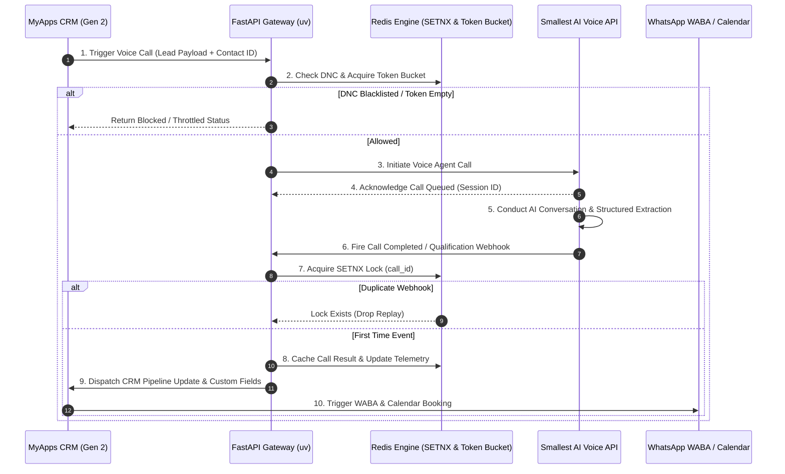

# High-Level Architecture Design (HLD)

## 1. Executive Overview
The **Smallest AI Voice Agent × MyApps CRM Integration System** provides an automated, closed-loop outbound voice calling, lead qualification, and pipeline orchestration engine.

---

## 2. System Architecture Topology

---

## 3. Subsystem Breakdown

### 3.1 Angular 20 Standalone Frontend (`/frontend`)
- **CSV Ingestion & Phone Sanitizer**: E.164 conversion & duplicate removal.
- **Batch Dispatch Controller**: Manages outbound voice campaign lifecycle.
- **MyApps CRM Visual Kanban Board**: Real-time pipeline stage movements.
- **Redis Cache Inspector**: Telemetry & active SETNX idempotency locks viewer.
- **Devil's Advocate Audit Module**: Interactive stress simulator.

### 3.2 `uv`-Managed FastAPI Gateway (`/backend`)
- **Stateless Router API**: REST & Webhook endpoints.
- **Async Redis Client**: High-throughput Redis connection pool with FakeRedis fallback.
- **Smallest AI SDK Integration**: Voice agent call triggers and transcript analysis.
- **MyApps CRM Webhook Engine**: Signature validation, retries, audit logging.

### 3.3 Redis Caching & Idempotency Layer
- **Token Bucket Rate Limiter**: Configurable throughput ceiling (max 10 calls/sec).
- **SETNX Idempotency Locks**: Key `webhook:idempotency:{call_id}` with 24-hour TTL.
- **DNC Blacklist Set**: Key `dnc:blacklist`.
- **Result Cache**: Key `call:result:{call_id}`.
