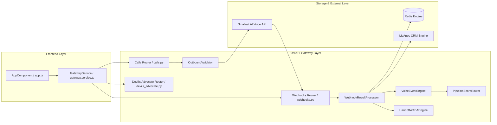

# 🗺️ Services Architecture & Code Map

This document maps all backend and frontend services in the **Smallest AI × MyApps CRM Ecosystem**, detailing responsibilities, API dependencies, caching patterns, and interaction boundaries.

---

## 1. Backend Service Inventory (`/backend/app`)

```text
backend/app/
├── config.py                 # AppConfig settings & environment validation
├── redis_engine.py           # Async Redis connection pool, Token Bucket, SETNX Locks
├── models/
│   └── crm_custom_fields.py  # Pydantic schemas for 5 CRM custom field categories
├── services/
│   ├── csv_sanitizer.py      # E.164 phone sanitizer & CSV parser
│   ├── smallest_ai.py        # Smallest AI voice agent API integration & mock generator
│   ├── crm_webhook.py        # MyApps CRM webhook pipeline update syncer
│   ├── pipeline_router.py    # 0-15 lead score router & visual stage selector
│   ├── outbound_validator.py # Pre-call validation (DNC, phone, schedule wait)
│   ├── voice_event_engine.py # 4-stage async voice event lifecycle processor
│   ├── result_processor.py   # Webhook HMAC signature verifier & SETNX deduplication
│   └── handoff_waba_engine.py# Calendar booking, WABA reminders, Human Handoff Brief
└── routers/
    ├── api_config.py         # Configuration management routes
    ├── calls.py              # CSV upload, single call, and batch dispatch routes
    ├── webhooks.py           # Inbound Smallest AI webhook & CRM receiver routes
    └── devils_advocate.py    # Interactive 6-scenario crash testing routes
```

---

## 2. Frontend Service Inventory (`/frontend/src/app`)

```text
frontend/src/app/
├── models/
│   └── app.models.ts         # TypeScript interfaces for Lead, CallResult, CRMItem, Telemetry
├── services/
│   └── gateway.service.ts    # HttpClient / Fetch service connecting to FastAPI Gateway (:8000)
├── app.ts                    # Standalone AppComponent managing Signals state
├── app.html                  # Responsive Glassmorphism template with Tabs & Dropzone
└── app.css                   # Custom theme styles
```

---

## 3. Service Interactions & Data Flow


